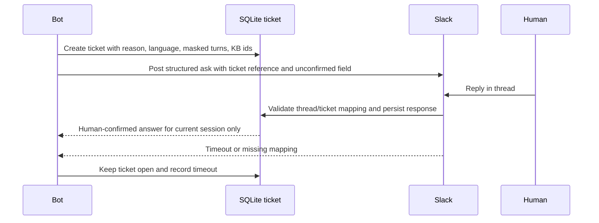

# Slack ask-a-human loop (design only)

Payload: ticket id, reason code, masked customer id, language, intent, exact question, KB ids, confidence, candidate answer and requested confirmation. Never post payment credentials, OTPs or unmasked personal details. Thread replies are matched to the existing ticket; invalid or late replies are ignored and the ticket remains open. On timeout, tell the customer the team will follow up; do not invent an answer. Maps to the existing tickets and ticket_messages tables.
